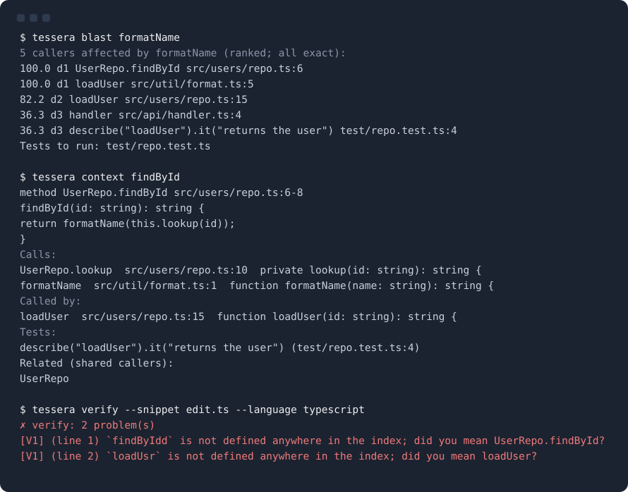
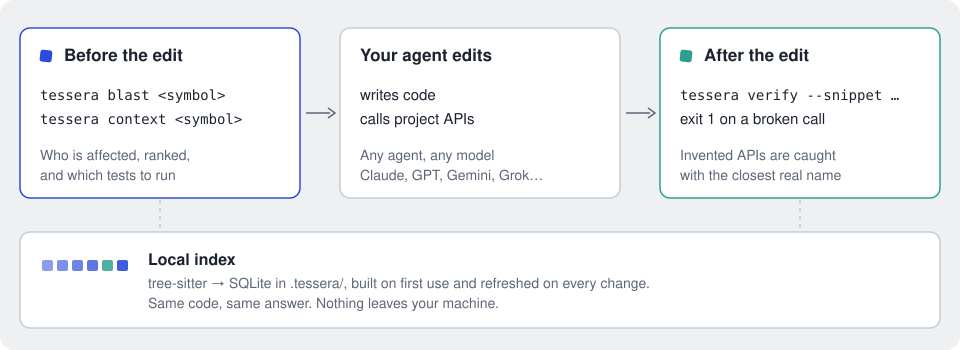
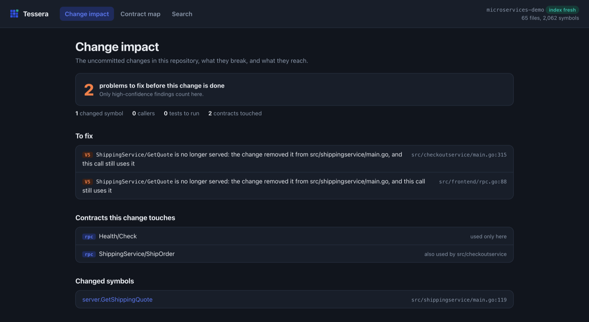
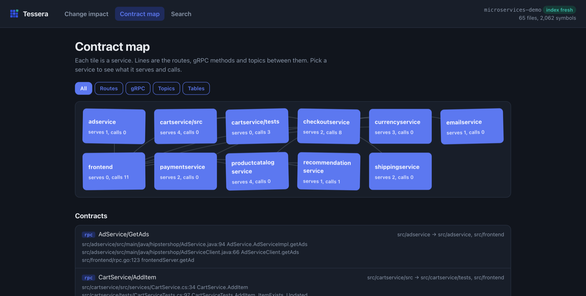

<p align="center">
  <picture>
    <source media="(prefers-color-scheme: dark)" srcset="assets/logo-dark.svg">
    
  </picture>
</p>

<h3 align="center">Your agent says done. Tessera checks.</h3>

<p align="center">
  Deterministic blast radius before every edit and verification after it, for any AI coding agent.<br>
  Local, no LLM, Apache-2.0.
</p>

<p align="center">
  <a href="https://github.com/iamsaquib8/tessera/actions/workflows/ci.yml"></a>
  <a href="https://crates.io/crates/tessera-codegraph"></a>
  <a href="https://www.npmjs.com/package/tessera-codegraph"></a>
  <a href="LICENSE"></a>
  <a href="https://iamsaquib8.github.io/tessera/"></a>
</p>

<p align="center">
  
</p>

## Why

Coding agents edit code they have only partly read. They grep, open a few
files, change a function, and report success. The caller in another module
that still passes the old arguments turns up later, in CI, in review, or in
production.

Tessera gives the agent an exact local map of the code and checks its work
against it:

- **Before an edit:** `blast` ranks every caller a change can affect and lists
  the tests to run. `context` returns the body, callers, and callees in one
  budgeted read instead of five file opens.
- **After an edit:** `verify` catches calls to names that do not exist, wrong
  argument counts, broken imports, and call sites a rename left behind.
  Hooks run it after every edit and hold the agent at "done" until the
  breakage is fixed, in Claude Code, Codex, Gemini CLI, Copilot, Cursor and
  more.
- **Across services:** `map` links HTTP routes, gRPC methods, GraphQL fields,
  Kafka topics, tables, and config keys to the code on both sides, in any
  language Tessera reads, so a changed endpoint shows the frontend code that
  calls it, and `verify` catches a removed route that a client still calls.
- **On every pull request:** the GitHub Action comments what the change
  breaks, who calls the changed code, and which tests to run.

The map is deterministic. tree-sitter parses, SQLite stores, and the same code
always gives the same answer. No model builds it, and nothing leaves your
machine.

## Quick start

Install the binary (macOS and Linux; checksum-verified, from the GitHub
release):

```sh
curl -fsSL https://raw.githubusercontent.com/iamsaquib8/tessera/main/install.sh | sh
```

Then, inside any repository:

```sh
tessera blast <symbol>
```

There is no setup step: the first query builds the index in `.tessera/`, and
every later query refreshes only what changed. Then wire it into your agents:

```sh
tessera init
```

The same commands run without installing anything (Node 18+):
`npx tessera-codegraph blast <symbol>` and `npx tessera-codegraph init`.

`init` finds the agents you use (Claude Code, Codex, Gemini CLI, Cursor,
Copilot and 16 more), shows the diff of every config change, and asks before
writing. It adds the MCP server and, where the agent supports them, the
[edit-safety hooks](docs/hooks.md). In Claude Code you can install the plugin
instead:

```text
/plugin marketplace add iamsaquib8/tessera
/plugin install tessera@tessera
```

Manual setup for every agent is in [docs/integrations.md](docs/integrations.md),
and everything else is on the [docs site](https://iamsaquib8.github.io/tessera/).

<details>
<summary>Other ways to install</summary>

```sh
npm i -g tessera-codegraph                       # Node 18+, prebuilt binary, no install scripts
cargo binstall tessera-codegraph                 # prebuilt via cargo-binstall
cargo install tessera-codegraph                  # from source, Rust 1.90+
```

A Homebrew tap and a public container image are not available yet.

On Windows, use npm, `cargo install`, or the `.zip` on the
[releases page](https://github.com/iamsaquib8/tessera/releases), which also
has archives for macOS and Linux (x86_64 and aarch64).

</details>

## How it works

<picture>
  <source media="(prefers-color-scheme: dark)" srcset="assets/how-it-works-dark.svg">
  
</picture>

| Command | Answers |
| --- | --- |
| `tessera blast <symbol>` / `--diff <rev>` | What does this change affect? Callers ranked by impact, plus tests to run |
| `tessera context <symbol>` | What do I need to read before editing this? |
| `tessera verify --changed` / `--staged` / `--diff <rev>` | Did this change break a call site, an argument count, or an import? Exits 1 if so |
| `tessera verify --snippet <file> --language <lang>` | Does everything this code calls exist? |
| `tessera find <symbol>` / `--path <file>` | Where is it defined? What is in this file? |
| `tessera refs <symbol \| file>` | Who calls it? Who imports this file? |
| `tessera cycles` | Which modules import each other circularly? |
| `tessera search <pattern>` / `--unused` | Which symbols match? Which functions are never called? |
| `tessera path <from> <to>` | Does A reach B, and how? Follows routes and gRPC calls across services |
| `tessera map <route\|rpc\|graphql\|topic\|table\|config\|service> [query]` | Which services call this endpoint, method, field, or topic? Who sets the config key this code reads? |
| `tessera map route --drift` | Do the routes served in code match the OpenAPI or Swagger documents? |
| `tessera affected <rev>` | Which tests does this change reach, and why? |
| `tessera ui` | What does my working tree change, and how do the services connect? In the browser |
| `tessera stats` | What did the edit hooks catch, and did the agent fix it? |
| `tessera export` | The call graph as Mermaid or Graphviz DOT |
| `tessera status` | Is the index fresh? Is anything misconfigured? |
| `tessera init` | Wire Tessera into the agents this project uses |

Eleven queries are also MCP tools (`tessera mcp`): `find`, `search`, `refs`,
`blast`, `verify`, `context`, `path`, `map`, `status`, `affected`, and
`import_cycles` (the CLI's `cycles`). The tools are read-only, paginated, and
return compact text so they cost few tokens ([docs/mcp.md](docs/mcp.md)).
Every command takes `--json`. See
[the five-minute tour](docs/first-five-minutes.md) for real output.

## See the impact

```sh
tessera ui --open
```

<p align="center">
  
  
</p>

A local page on `127.0.0.1` shows what your uncommitted work touches:
blocking problems, changed symbols, their callers ranked by impact,
contracts with services on the other side, and the tests to run. The
contract map draws services and the routes, gRPC methods, and topics
between them, grouped by directory when there are many, and lists every
contract with its tables; every symbol links to its definition, callers,
and tests. Nothing loads from the network. `tessera ui --export
site/` writes the same page as a static site for a demo or an internal wiki.

## On every pull request

```yaml
# .github/workflows/tessera.yml
name: Tessera
on: pull_request
permissions:
  contents: read
  pull-requests: write
jobs:
  tessera:
    runs-on: ubuntu-latest
    steps:
      - uses: actions/checkout@v4
      - uses: iamsaquib8/tessera/action@v1
        with:
          fail-on: blocking   # or `never` (default) to only comment
```

One comment per pull request, updated on every push: problems to fix,
contracts the change touches, callers of the changed code, tests to run,
and changed functions no test reaches. On forks it writes the job summary
instead. The same report is `tessera verify --diff <base> --format
markdown` for any other CI. [action/README.md](action/README.md) lists the
inputs, including `upload-sarif` for code scanning.

- **Run only the tests the change reaches.** `tessera affected origin/main`
  lists them, each with the chain from the test to the changed code;
  lockfile, build-file and CI-configuration changes run everything and
  say why. `--format jest | vitest | pytest | go-test | cargo` prints the
  command. The Action exposes the list as the `tests` and `tests-file`
  outputs, and the reason to run everything as `full-run`. On three public
  monorepos it selected 249 of 251 failing test files after seeded breaks
  ([ROADMAP.md](ROADMAP.md)).
- **Adopt it on a codebase with known problems.** `tessera baseline`
  records today's findings so only new ones block; `tessera accept
  <fingerprint> --reason …` records an intended break, with an optional
  expiry.
- **Any CI, any review tool.** `verify --format` takes `human`, `agent`,
  `json`, `sarif`, `markdown`, `gitlab` (Code Quality), `azure`, `bitbucket`
  (Code Insights), `ndjson` and `junit`. `tessera cache export <file>` and
  `tessera cache import <file>` carry the index between CI runs. See
  [docs/ci.md](docs/ci.md).

## Works with every agent and every model

Tessera never calls a model, so Claude, GPT, Gemini, Grok, DeepSeek, Qwen, and
local models all work. `tessera init` sets up each agent below.

| Agent | MCP tools | Checks every edit |
| --- | --- | --- |
| Claude Code | ✓ | ✓ plugin or `init` |
| Codex CLI | ✓ | ✓ |
| Gemini CLI | ✓ | ✓ |
| GitHub Copilot CLI | ✓ | ✓ |
| Cursor | ✓ | ✓ |
| Qwen Code | ✓ | ✓ |
| Augment (Auggie) | ✓ `--global` | ✓ |
| Google Antigravity | ✓ | ✓ reported at stop |
| VS Code Copilot agent | ✓ | git hook |
| Grok Build | ✓ | git hook |
| OpenCode | ✓ | git hook |
| Kilo Code | ✓ | git hook |
| Kiro | ✓ | git hook |
| JetBrains Junie | ✓ | git hook |
| Amp | ✓ | git hook |
| Warp | ✓ | git hook |
| Continue | ✓ | git hook |
| Cline | ✓ `--global` | git hook |
| Devin Desktop | ✓ `--global` | git hook |
| Zed | ✓ `--global` | git hook |
| Goose | ✓ `--global` | git hook |
| Aider | lint loop | git hook |

**Checks every edit** means hooks that run `verify` after each edit and
hold the agent at "done" while a break remains ([docs/hooks.md](docs/hooks.md)).
**git hook** is `tessera init --git-hook`: a pre-commit check that refuses a
commit that breaks a call site or an import, for any agent and for people.
`--global` agents keep MCP config only in the home directory. Config for each
agent is in [docs/integrations.md](docs/integrations.md); the sourced matrix
of hook capabilities is in [docs/agents.md](docs/agents.md).

## Languages

TypeScript, TSX/React, JavaScript (ESM and CommonJS), Java, Python, Go, Rust,
C, C++, C#, Ruby, PHP. TypeScript interfaces, type aliases and enums are
indexed as symbols.

**Deep tier: TypeScript, TSX, JavaScript, and Java.** References resolve
through imports, re-exports, tsconfig paths, workspace packages, Java
packages, declared types, and overloads, and every one carries a confidence.
Against scip-typescript and scip-java ground truth on excalidraw, nest,
Ghost core, and two Spring applications, a high-confidence reference is
right **99.8%** of the time in TypeScript/JavaScript and **99.5%** in Java.
Tessera finds 99.0% of direct calls, 91.2% of calls on typed receivers, and
98.6% of type references in TypeScript/JavaScript, and 87.2%, 93.5% and
100% in Java. Some repositories fall below the release gate in one category
(Ghost's typed receivers, for one), and the Java sample is small: read the
numbers with their sample sizes in [accuracy](docs/accuracy.md).

The other languages are at the **standard** tier: resolved within a file and
by unique name, labelled when a match is only possible.
[Current limits](docs/when-not-to-use.md) are listed plainly.

Contracts between services are read for gRPC in Go, C#, Node, Python, Java
and C++; for HTTP in Express, Fastify, NestJS, Next.js, Spring, Go
(`net/http`, chi, gin, echo), FastAPI, Flask, Django, Rails, Sinatra,
actix-web, Slim and ASP.NET minimal APIs, with their clients; and for Kafka,
GraphQL, config keys, and SQL, JPA, TypeORM, Sequelize and Prisma tables
([docs/contracts.md](docs/contracts.md)). Hand-labelled on
microservices-demo, 15 of 15 gRPC servers and 34 of 34 clients link, with no
wrong links; HTTP client recall is lower where a URL is assembled at
runtime ([measured](docs/contracts.md#accuracy)).

`tessera map route --drift` compares the routes declared in OpenAPI 3 and
Swagger documents with the routes served in code, and lists those served but
not documented, documented but not served, or served under another method
([spec drift](docs/contracts.md#spec-drift)). The Slim and ASP.NET packs,
spec drift and `verify --format junit` are on `main` and not yet in a
release; the other commands, formats and packs here are in 1.2.0.

## FAQ

**Why not just run `tsc` or use an LSP?** Run them too. Tessera checks only
the changed code against an index of the whole repository, so it fits in an
agent's edit loop. It works the same way in all twelve languages, including
JavaScript, Python, and Ruby projects that have no type checker, and it
covers breaks between services that no compiler sees. An LSP answers one
editor's questions about one project; Tessera keeps one index for the whole
repository, or a workspace of repositories, that any agent can query.

**Does my code leave my machine?** No. The index is a SQLite file in
`.tessera/`, gitignored automatically. Tessera makes no network calls, and
`blast --diff` runs only a local `git diff`.

**Is it accurate?** Measured, not claimed: on public TypeScript,
JavaScript, and Java repositories, 99.8% (TypeScript/JavaScript) and 99.5%
(Java) of high-confidence references match SCIP ground truth
([accuracy](docs/accuracy.md)). Weaker matches are labelled, never silent.
The benchmark is public ([tessera-bench](https://github.com/iamsaquib8/tessera-bench)),
so you can check the numbers yourself.

**Will it slow my agent down?** The MCP server keeps the index fresh in the
background as files change. A CLI query first checks that the index is
fresh, a stat walk of the repository. Perf budgets run in CI on a synthetic
10,000-file index: the freshness check under 100 ms, and `find` and `refs`
under 50 ms at p95 ([tests/perf.rs](tests/perf.rs)). Indexing is incremental.

**Can I build on it?** Yes. Commands, flags, `--json` fields, MCP tool
schemas, hook replies, and exit codes are stable for 1.x, and a test suite
pins them ([docs/stability.md](docs/stability.md)).

## Roadmap

Released: v1.0 and, in 1.2.0, the completed contract map (v1.1) and team and
CI features (v1.2). Next are every install channel published on every
release (1.2.x), no silent wrong answers (v1.3), and the public launch
(v1.4). [ROADMAP.md](ROADMAP.md) has every planned version through v2.0 and
what proves each one done.

## Contributing

New languages, framework packs, and agent adapters are small, self-contained
pull requests with fixtures. [CONTRIBUTING.md](CONTRIBUTING.md) explains each
one. Issues labelled
[`good first issue`](https://github.com/iamsaquib8/tessera/labels/good%20first%20issue)
are scoped for a first PR.

If Tessera saves your agent from a bad edit, a star helps other people find it.

## License

Apache-2.0. See [LICENSE](LICENSE).
