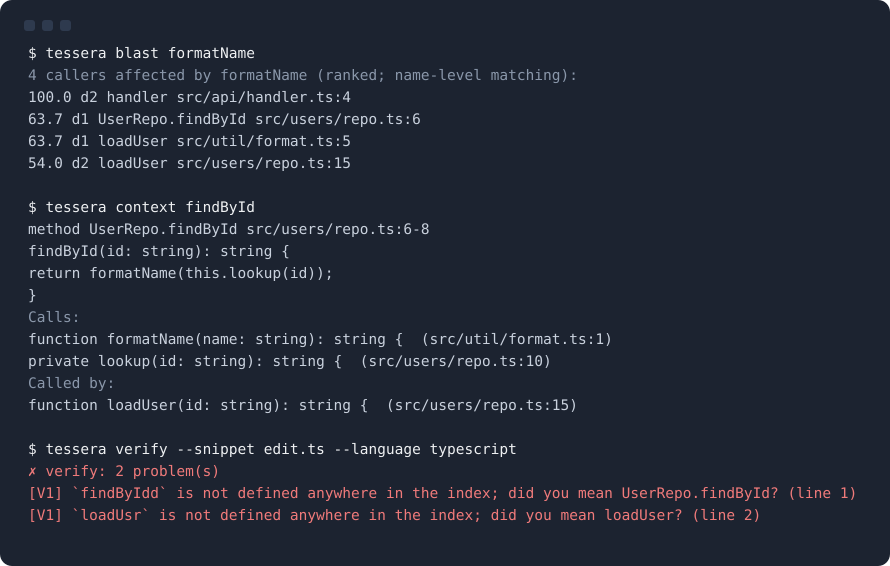
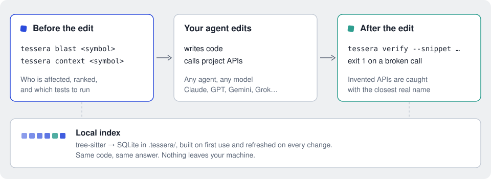
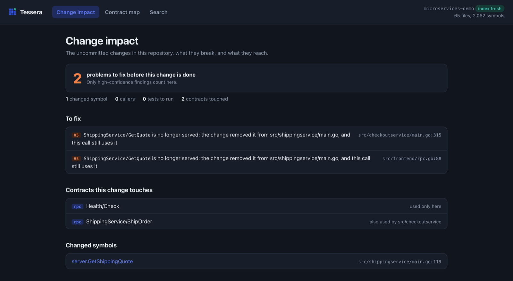
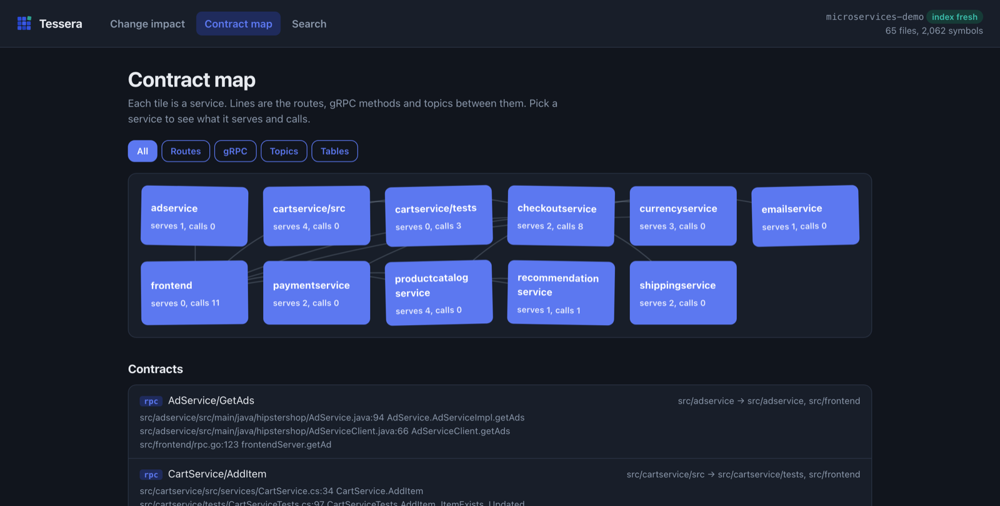

<p align="center">
  <picture>
    <source media="(prefers-color-scheme: dark)" srcset="assets/logo-dark.svg">
    
  </picture>
</p>

<h3 align="center">Your agent says done. Tessera checks.</h3>

<p align="center">
  Deterministic blast radius before every edit and verification after it, for any AI coding agent.<br>
  Local, no LLM, Apache-2.0.
</p>

<p align="center">
  <a href="https://github.com/iamsaquib8/tessera/actions/workflows/ci.yml"></a>
  <a href="https://crates.io/crates/tessera-codegraph"></a>
  <a href="https://www.npmjs.com/package/tessera-codegraph"></a>
  <a href="LICENSE"></a>
</p>

<p align="center">
  English ·
  <a href="README.zh-CN.md">简体中文</a> ·
  <a href="README.ja.md">日本語</a> ·
  <a href="README.ko.md">한국어</a> ·
  <a href="README.es.md">Español</a> ·
  <a href="README.pt-BR.md">Português (Brasil)</a>
</p>

<p align="center">
  
</p>

## Why

Coding agents edit code they have only partly read. They grep, open a few
files, change a function, and report success. The caller in another module
that still passes the old arguments turns up later, in CI, in review, or in
production.

Tessera gives the agent an exact local map of the code and checks its work
against it:

- **Before an edit:** `blast` ranks every caller a change can affect and lists
  the tests to run. `context` returns the body, callers, and callees in one
  budgeted read instead of five file opens.
- **After an edit:** `verify` catches calls to names that do not exist, wrong
  argument counts, broken imports, and call sites a rename left behind.
  Hooks run it after every edit and hold the agent at "done" until the
  breakage is fixed, in Claude Code, Codex, Gemini CLI, Copilot, Cursor and
  more.
- **Across services:** `map` links HTTP routes, gRPC methods, Kafka topics,
  and tables to the code on both sides, in any language Tessera reads, so a
  changed endpoint shows the frontend code that calls it, and `verify`
  catches a removed route that a client still calls.
- **On every pull request:** the GitHub Action comments what the change
  breaks, who calls the changed code, and which tests to run.

The map is deterministic. tree-sitter parses, SQLite stores, and the same code
always gives the same answer. No model builds it, and nothing leaves your
machine.

## Quick start

Inside any repository:

```sh
npx tessera-codegraph blast <symbol>
```

There is no setup step: the first query builds the index in `.tessera/`, and
every later query refreshes only what changed. Then wire it into your agents:

```sh
npx tessera-codegraph init
```

`init` finds the agents you use (Claude Code, Codex, Gemini CLI, Cursor,
Copilot and 16 more), shows the diff of every config change, and asks before
writing. It adds the MCP server and, where the agent supports them, the
[edit-safety hooks](docs/hooks.md). In Claude Code you can install the plugin
instead:

```text
/plugin marketplace add iamsaquib8/tessera
/plugin install tessera@tessera
```

Manual setup for every agent is in [docs/integrations.md](docs/integrations.md).

<details>
<summary>Other ways to install</summary>

```sh
npm i -g tessera-codegraph                       # Node 18+, prebuilt binary, no install scripts
brew install iamsaquib8/tessera/tessera          # macOS and Linux
curl -fsSL https://raw.githubusercontent.com/iamsaquib8/tessera/main/install.sh | sh   # checksum-verified
cargo binstall tessera-codegraph                 # prebuilt via cargo-binstall
cargo install tessera-codegraph                  # from source, Rust 1.90+
docker run --rm -v "$PWD:/work" ghcr.io/iamsaquib8/tessera status
```

</details>

## How it works

<picture>
  <source media="(prefers-color-scheme: dark)" srcset="assets/how-it-works-dark.svg">
  
</picture>

| Command | Answers |
| --- | --- |
| `tessera blast <symbol>` / `--diff <rev>` | What does this change affect? Callers ranked by impact, plus tests to run |
| `tessera context <symbol>` | What do I need to read before editing this? |
| `tessera verify --changed` / `--staged` / `--diff <rev>` | Did this change break a call site, an argument count, or an import? Exits 1 if so |
| `tessera verify --snippet <file> --language <lang>` | Does everything this code calls exist? |
| `tessera find <symbol>` / `--path <file>` | Where is it defined? What is in this file? |
| `tessera refs <symbol \| file>` | Who calls it? Who imports this file? |
| `tessera search <pattern>` / `--unused` | Which symbols match? Which functions are never called? |
| `tessera path <from> <to>` | Does A reach B, and how? Follows routes and gRPC calls across services |
| `tessera map <route\|rpc\|topic\|table\|service> [query]` | Which services call this endpoint, method, topic, or table? |
| `tessera ui` | What does my working tree change, and how do the services connect? In the browser |
| `tessera status` | Is the index fresh? Is anything misconfigured? |
| `tessera init` | Wire Tessera into the agents this project uses |

The queries are also MCP tools (`tessera mcp`). The tools are read-only,
paginated, and return compact text so they cost few tokens. Every command
takes `--json`. See [the five-minute tour](docs/first-five-minutes.md) for
real output.

## See the impact

```sh
tessera ui --open
```

<p align="center">
  
  
</p>

A local page on `127.0.0.1` shows what your uncommitted work touches:
blocking problems, changed symbols, their callers ranked by impact,
contracts with services on the other side, and the tests to run. The
contract map draws services and the routes, gRPC methods, and topics
between them, grouped by directory when there are many, and lists every
contract with its tables; every symbol links to its definition, callers,
and tests. Nothing loads from the network. `tessera ui --export
site/` writes the same page as a static site for a demo or an internal wiki.

## On every pull request

```yaml
# .github/workflows/tessera.yml
name: Tessera
on: pull_request
permissions:
  contents: read
  pull-requests: write
jobs:
  tessera:
    runs-on: ubuntu-latest
    steps:
      - uses: actions/checkout@v4
      - uses: iamsaquib8/tessera/action@v1
        with:
          fail-on: blocking   # or `never` (default) to only comment
```

One comment per pull request, updated on every push: problems to fix,
contracts the change touches, callers of the changed code, and tests to
run. On forks it writes the job summary instead. The same report is
`tessera verify --diff <base> --format markdown` for any other CI.
[action/README.md](action/README.md) lists the inputs.

## Works with every agent and every model

Tessera never calls a model, so Claude, GPT, Gemini, Grok, DeepSeek, Qwen, and
local models all work. `tessera init` sets up each agent below.

| Agent | MCP tools | Checks every edit |
| --- | --- | --- |
| Claude Code | ✓ | ✓ plugin or `init` |
| Codex CLI | ✓ | ✓ |
| Gemini CLI | ✓ | ✓ |
| GitHub Copilot CLI | ✓ | ✓ |
| Cursor | ✓ | ✓ |
| Qwen Code | ✓ | ✓ |
| Augment (Auggie) | ✓ `--global` | ✓ |
| Google Antigravity | ✓ | ✓ reported at stop |
| VS Code Copilot agent | ✓ | git hook |
| Grok Build | ✓ | git hook |
| OpenCode | ✓ | git hook |
| Kilo Code | ✓ | git hook |
| Kiro | ✓ | git hook |
| JetBrains Junie | ✓ | git hook |
| Amp | ✓ | git hook |
| Warp | ✓ | git hook |
| Continue | ✓ | git hook |
| Cline | ✓ `--global` | git hook |
| Devin Desktop | ✓ `--global` | git hook |
| Zed | ✓ `--global` | git hook |
| Goose | ✓ `--global` | git hook |
| Aider | lint loop | git hook |

**Checks every edit** means hooks that run `verify` after each edit and
hold the agent at "done" while a break remains ([docs/hooks.md](docs/hooks.md)).
**git hook** is `tessera init --git-hook`: a pre-commit check that refuses a
commit that breaks a call site or an import, for any agent and for people.
`--global` agents keep MCP config only in the home directory. Config for each
agent is in [docs/integrations.md](docs/integrations.md); the sourced matrix
of hook capabilities is in [docs/agents.md](docs/agents.md).

## Languages

TypeScript, TSX/React, JavaScript (ESM and CommonJS), Java, Python, Go, Rust,
C, C++, C#, Ruby, PHP.

**Deep tier: TypeScript, TSX, JavaScript, and Java.** References resolve
through imports, re-exports, tsconfig paths, workspace packages, Java
packages, declared types, and overloads, and every one carries a confidence.
Against compiler ground truth on excalidraw, nest, Ghost, and two Spring
applications, high-confidence results are right **99.7%** of the time, and
Tessera finds 99% of direct calls, 91% of calls on typed receivers, and 99%
of type references in TypeScript/JavaScript ([accuracy](docs/accuracy.md)).

The other languages are at the **standard** tier: resolved within a file and
by unique name, labelled when a match is only possible.
[Current limits](docs/when-not-to-use.md) are listed plainly.

Contracts between services are read in every language that has them: gRPC in
Go, C#, Node, Python, Java and C++; HTTP in Express, Fastify, NestJS,
Next.js, Spring and their clients; Kafka; SQL, JPA, TypeORM, Sequelize and
Prisma ([docs/contracts.md](docs/contracts.md)).

## FAQ

**Why not just run `tsc` or use an LSP?** Run them too. Tessera checks only
the changed code against an index of the whole repository, so it fits in an
agent's edit loop. It works the same way in all twelve languages, including
JavaScript, Python, and Ruby projects that have no type checker, and it
covers breaks between services that no compiler sees. An LSP answers one
editor's questions about one project; Tessera keeps one index for the whole
repository, or a workspace of repositories, that any agent can query.

**Does my code leave my machine?** No. The index is a SQLite file in
`.tessera/`, gitignored automatically. Tessera makes no network calls, and
`blast --diff` runs only a local `git diff`.

**Is it accurate?** Measured, not claimed: on public TypeScript,
JavaScript, and Java repositories, 99.7% of high-confidence references match
the compiler's ground truth ([accuracy](docs/accuracy.md)). Weaker matches are
labelled, never silent. The benchmark, its ground truth, and adapters for
other code-graph tools are public, so you can check the numbers yourself.

**Will it slow my agent down?** Through the MCP server, lookups take
milliseconds: the server keeps the index fresh in the background as files
change. A CLI query first checks that the index is fresh, a stat walk of the
repository. Perf budgets run in CI: freshness check under 100 ms and lookups
under 50 ms at p95 on 10,000 files. Indexing is incremental.

**Can I build on it?** Yes. Commands, flags, `--json` fields, MCP tool
schemas, hook replies, and exit codes are stable for 1.x, and a test suite
pins them ([docs/stability.md](docs/stability.md)).

## Roadmap

| Version | Milestone |
| --- | --- |
| v0.10 | Foundation: index any repo, zero setup, MCP for every agent |
| v0.11 | Precision: import- and type-aware resolution, public accuracy benchmark |
| v0.12 | Edit-safety loop: hooks that check every edit, `tessera init`, Claude Code plugin, git backstop |
| v0.13 | Contract map: routes, gRPC, topics, and tables across services and repositories |
| v1.0 | Change-impact UI, GitHub Action, stable contracts (this release) |
| v1.1 | Contract map completed: mounted routers, GraphQL, config keys, `path` across repositories, Go/Python/Ruby web frameworks |
| v1.2 | Team and CI: test selection, a shared index cache, findings in code scanning |
| v1.x | Architecture rules, SCIP precise mode, editor extensions, runtime traces, data lineage, refactor plans |

See [ROADMAP.md](ROADMAP.md) for each theme and what proves it done.

## Contributing

New languages, framework packs, and agent adapters are small, self-contained
pull requests with fixtures. [CONTRIBUTING.md](CONTRIBUTING.md) explains each
one. Issues labelled
[`good first issue`](https://github.com/iamsaquib8/tessera/labels/good%20first%20issue)
are scoped for a first PR.

If Tessera saves your agent from a bad edit, a star helps other people find it.

## License

Apache-2.0. See [LICENSE](LICENSE).
